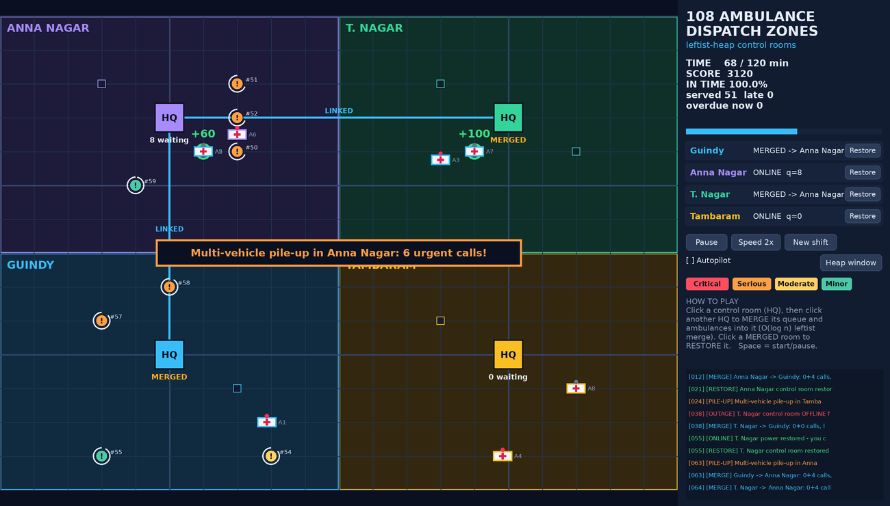
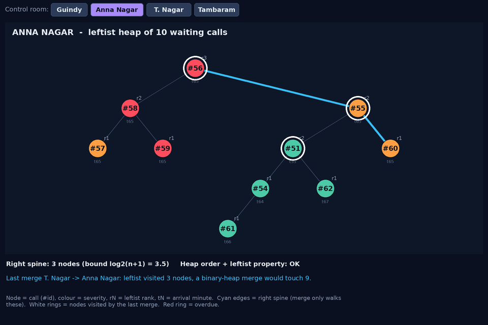

# 108 Ambulance Dispatch Zones
**A Leftist Heap based emergency call dispatch game**

M.Tech Artificial Intelligence and Data Science, First Year
IF3151 Advanced Data Structures and Algorithms, College of Engineering, Guindy (Anna University)
Author: Subiksha UB




## Idea
Each of four control rooms (Guindy, Anna Nagar, T. Nagar, Tambaram) keeps its waiting 108 calls in a
**leftist heap** ordered by severity (critical, serious, moderate, minor) and then by arrival time.
When a room goes offline or is swamped, its queue must be combined with another room's *immediately*.
A binary heap needs O(n) to merge two queues. A leftist heap does it in **O(log n)**.

## The game
* **City map** with four districts on a road grid. Calls appear as pins with a countdown ring (time left to reach the scene).
* **Ambulances** drive along the roads from their station to the most urgent call, stay on scene, and drive back.
  The control room always dispatches the heap's minimum (most urgent) call to the nearest idle ambulance.
* **Events:** random calls, multi-vehicle pile-ups (a cluster of urgent calls) and control-room power outages
  (the room's queue freezes and its ambulances cannot be dispatched).
* **Your moves:** click a control room, then click another to **merge** its queue *and ambulances* into it.
  Failover rescues an offline room's calls; pooling lends idle ambulances to a swamped room, but they have to drive further.
  Click a merged room to **restore** it.
* **Score:** +100/60/40/20 for reaching a critical/serious/moderate/minor call in time, penalties when a call expires or is reached late.
* **Heap window:** a separate window draws the selected room's heap as a live tree (node colour = severity, rN = rank,
  cyan edges = right spine). After a merge, the nodes the merge visited are ringed in white and the analyzer compares
  leftist node visits with the n1+n2 nodes a binary-heap merge would touch.
* **Autopilot** plays the built-in failover + pooling policy. Space = start/pause.

## Where the data structure is used
| Game event | Heap operation | Cost |
|---|---|---|
| New call arrives | `lh_insert` = merge with a 1-node heap | O(log n) |
| Ambulance free, next call dispatched | `lh_pop` = merge(left, right) of the root | O(log n) |
| Outage failover, or pooling rooms | `lh_merge` of two whole queues | O(log n) |
| Live validation (heap order, leftist property, ranks) | `lh_validate` | O(n), UI/debug only |

Leftist property: `rank(left) >= rank(right)`, rank = null-path length. The right spine is at most log2(n+1) nodes,
and `merge` only walks right spines.

## Build and run
Requirements: `gcc`, `make`, Python 3 with Tkinter (Linux/macOS; on Windows use WSL or MinGW).
```
make           # builds build/libdispatch.so, the unit tests and the simulator
make test      # leftist heap unit tests
make sim       # 30 random shifts: no merging vs failover + pooling
make play      # opens the game (python3 gui/main.py)
```

## Layout
```
src/leftist_heap.[ch]  leftist heap ADT (merge, insert, delete-min, validate, merge trace)
src/game.[ch]          game engine in C: map, calls, ambulances, outages, scoring, merges, autopilot
src/test_heap.c        unit tests            src/sim.c  headless benchmark
gui/engine.py          ctypes bridge         gui/render.py  map + tree drawing    gui/main.py  Tkinter game + heap window
```

## Measured results (`make test`, `make sim`)
* Merging two heaps of 2,000 calls each took 12 node visits, versus 4,000 for a binary-heap rebuild.
* Over 30 random shifts, calls reached in time rose from 85.2% (no merging) to 93.8% (failover + pooling).
